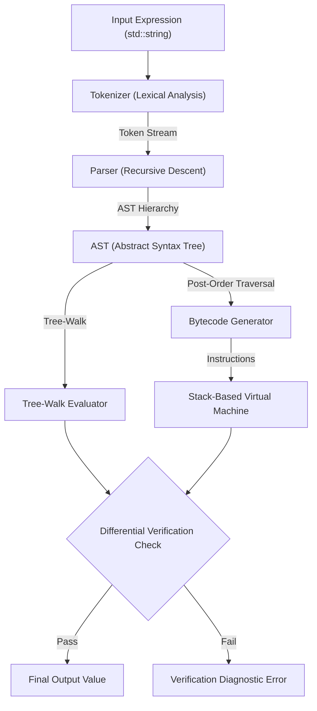

# Mini Expression Compiler

[](https://en.cppreference.com/w/cpp/17)
[](https://cmake.org/)

A lightweight, robust command-line arithmetic expression compiler, Abstract Syntax Tree (AST) generator, and stack-based bytecode virtual machine written in modern C++17.

Designed to demonstrate core compiler frontend and backend principles: **lexical analysis**, **recursive-descent parsing with operator precedence**, **intermediate representation (AST)**, **stack-based bytecode compilation**, and **differential verification**.

---

## Table of Contents
1. [Core Features](#core-features)
2. [Tokenization vs Parsing vs Evaluation](#tokenization-vs-parsing-vs-evaluation)
3. [Architecture and Pipeline Flow](#architecture-and-pipeline-flow)
4. [Grammar Rules & Precedence](#grammar-rules--precedence)
5. [Intermediate Representation (AST & Bytecode)](#intermediate-representation-ast--bytecode)
6. [Compiler Verification Strategy](#compiler-verification-strategy)
7. [Project Structure](#project-structure)
8. [Building and Running](#building-and-running)
9. [Automated Verification Suite](#automated-verification-suite)
10. [Sample CLI Usage & Outputs](#sample-cli-usage--outputs)
11. [Design Decisions & Trade-offs](#design-decisions--trade-offs)
12. [Future Improvements](#future-improvements)

---

## Core Features

- **Lexical Analysis (Tokenizer)**:
  - Scans integers and decimals (e.g. `42`, `3.14159`, `.5`).
  - Operators: `+`, `-`, `*`, `/`.
  - Nested grouping parentheses `(` and `)`.
  - Whitespace-insensitive (handles spaces, tabs, newlines).
  - Exact 1-based column tracking for compiler diagnostics.
- **Syntactic Analysis (Recursive-Descent Parser)**:
  - Strict formal grammar enforcing standard arithmetic operator precedence (`*`/`/` over `+`/`-`).
  - Left-associative binary operator chaining (`10 - 4 - 2` = `4`).
  - Unary minus and plus support (`-5`, `-(3 + 2)`, `- - 5`).
  - Detects syntax anomalies: unclosed parentheses, missing operands, empty parentheses `()`, unexpected tokens.
- **Rich Diagnostic Error Reporting**:
  - Clang/GCC style caret diagnostics pointing to the exact column of syntax/lexical violations.
  - Clear explanations rather than cryptic errors or segfaults.
- **Dual Execution Backends**:
  - **AST Tree-Walk Interpreter**: Evaluates the syntax tree directly via recursive traversal.
  - **Stack-Based Bytecode VM**: Compiles the AST into post-order bytecode instructions (`PUSH`, `ADD`, `SUB`, `MUL`, `DIV`, `NEG`) and executes on an evaluation stack.
- **Differential Compiler Verification**:
  - Automatically verifies that tree-walk evaluation and stack VM bytecode execution yield identical results within floating-point tolerance on every compiled expression.
- **Zero External Dependencies**:
  - Uses strictly standard ISO C++17.
  - Portable across GCC, Clang, and MSVC.

---

## Tokenization vs Parsing vs Evaluation

To understand a compiler, it helps to distinguish the three fundamental phases:

```
Source Code: "10 + 2 * 3"
     │
     ▼ [Phase 1: Tokenization / Lexer]
Tokens: [Number(10), Plus(+), Number(2), Multiply(*), Number(3), EOF]
     │
     ▼ [Phase 2: Parsing / Syntactic Analysis]
AST:      +
        /   \
       10    *
            / \
           2   3
     │
     ▼ [Phase 3: Evaluation / Code Execution]
Result: 16  (Or compiled into stack bytecode: PUSH 10, PUSH 2, PUSH 3, MUL, ADD)
```

| Phase | Purpose | What it Answers | Analogy |
|---|---|---|---|
| **Tokenization (Lexing)** | Breaks the raw text stream into meaningful atomic units (tokens). | *"Are these characters valid words/symbols in the language?"* | Recognizing words in English (e.g., nouns, verbs, punctuation). |
| **Parsing (Grammar Analysis)** | Verifies structural syntax and builds a hierarchical AST according to grammar rules. | *"Do these words form grammatically correct sentences following precedence?"* | Checking English sentence grammar and building a sentence diagram. |
| **Evaluation / CodeGen** | Walks the AST or executes bytecode to compute the actual mathematical result. | *"What is the semantic meaning/result of this statement?"* | Understanding the meaning of the sentence and executing an instruction. |

---

## Architecture and Pipeline Flow

The compilation process is encapsulated in `Compiler::compile(expression)`:



---

## Grammar Rules & Precedence

The parser implements a formal LL(1) context-free grammar using recursive descent. Precedence is encoded naturally in the grammar hierarchy: lower levels of the grammar bind more tightly.

```ebnf
Expression ::= Term ( ( '+' | '-' ) Term )*
Term       ::= Factor ( ( '*' | '/' ) Factor )*
Factor     ::= ( '+' | '-' ) Factor | Primary
Primary    ::= NUMBER | '(' Expression ')'
```

### Precedence Table

| Precedence | Level | Operators | Associativity | Grammar Non-Terminal |
|:---:|:---:|:---:|:---:|:---:|
| 1 (Highest) | Primary | Number, `( <expr> )` | N/A | `Primary` |
| 2 | Unary | `+` (unary), `-` (negation) | Right-to-Left | `Factor` |
| 3 | Multiplicative | `*`, `/` | Left-to-Right | `Term` |
| 4 (Lowest) | Additive | `+`, `-` | Left-to-Right | `Expression` |

---

## Intermediate Representation (AST & Bytecode)

### 1. Abstract Syntax Tree (AST)
Expressions are represented in an object-oriented tree structure:
- `NumberNode`: Leaf node holding numeric constant values.
- `BinaryOpNode`: Node holding left and right subtrees and an operator (`+`, `-`, `*`, `/`).
- `UnaryOpNode`: Node holding a single child operand and unary operator (`+`, `-`).

For the expression `(10 + 2) * -3`:
```
  BinaryOp(*)
  ├── BinaryOp(+)
  │   ├── Number(10)
  │   └── Number(2)
  └── UnaryOp(-)
      └── Number(3)
```
S-Expression: `(* (+ 10 2) (- 3))`

### 2. Stack-Based Bytecode
The AST generates post-order stack instructions targeting a virtual machine:
```
  0:  PUSH 10
  1:  PUSH 2
  2:  ADD
  3:  PUSH 3
  4:  NEG
  5:  MUL
```
Evaluation Stack Progression:
1. `PUSH 10` -> `[10]`
2. `PUSH 2`  -> `[10, 2]`
3. `ADD`     -> `[12]`
4. `PUSH 3`  -> `[12, 3]`
5. `NEG`     -> `[12, -3]`
6. `MUL`     -> `[-36]` (Final result)

---

## Compiler Verification Strategy

For compiler engineers and verification roles at companies like NVIDIA, testing and verification are paramount. This project implements:

1. **Differential Testing**:
   The compiler contains two completely distinct evaluation implementations:
   - Direct AST evaluation (`ASTNode::evaluate()`)
   - Linear Bytecode execution (`StackMachine::execute()`)
   On every expression, both backends execute independently, and their outputs are verified to be equivalent within $\epsilon = 10^{-9}$. Any deviation flags an internal compiler regression.
2. **Negative / Fault Injection Testing**:
   Verifies that invalid expressions (syntax errors, lexical errors, division by zero, stack corruptions) trigger well-defined exceptions rather than memory corruption or unexpected aborts.
3. **Boundary Condition & Stress Testing**:
   Deep nesting (parentheses depth 4+), unary chaining (`- - - 5`), decimal formatting (`.5`, `0.5`, `10.5`), and trailing characters are comprehensively tested.

---

## Project Structure

```
mini-expression-compiler/
├── CMakeLists.txt              # CMake build definitions (C++17, compiler flags, CTest)
├── README.md                   # Project documentation and interview guide
├── .gitignore                  # Git ignore rules for build artifacts
├── include/
│   ├── Tokenizer.hpp           # Lexical analysis declarations and Token definition
│   ├── AST.hpp                 # Abstract Syntax Tree hierarchy
│   ├── Bytecode.hpp            # Stack machine opcodes, instructions, and VM
│   ├── Parser.hpp              # Recursive-descent parser declarations
│   └── Compiler.hpp            # Compiler driver and pipeline facade
├── src/
│   ├── Tokenizer.cpp           # Tokenizer implementation & numeric literal parsing
│   ├── AST.cpp                 # AST evaluation, tree pretty-printer, code emission
│   ├── Bytecode.cpp            # Stack virtual machine execution and disassembler
│   ├── Parser.cpp              # Parser implementation & caret diagnostic generator
│   ├── Compiler.cpp            # Pipeline orchestration & differential verification
│   └── main.cpp                # Command-line driver & interactive REPL
└── tests/
    └── test_parser.cpp         # 51-case automated verification test suite
```

---

## Building and Running

### Prerequisites
- C++17 compatible compiler (GCC $\ge$ 7, Clang $\ge$ 5, or MSVC $\ge$ 2017)
- CMake $\ge$ 3.14
- Build tool (Ninja or Make)

### Step 1: Configure & Build
```bash
# Configure build directory
cmake -B build -S .

# Build all targets (compiler and test suite)
cmake --build build
```

On Windows with MinGW Makefiles:
```powershell
cmake -G "MinGW Makefiles" -B build -S .
cmake --build build
```

---

## Automated Verification Suite

Run all verification tests using the custom test runner or CTest:

```bash
# Direct test executable (detailed per-test output)
./build/test_parser

# Via CTest
ctest --test-dir build --output-on-failure
```

### Verification Suite Coverage (51 Test Cases)
- **Suite 1: Basic Arithmetic** (Addition, Subtraction, Multiplication, Division, Chaining)
- **Suite 2: Operator Precedence** (`10 + 2 * 3` -> 16, `5 + 2 * 4 - 6 / 2` -> 10)
- **Suite 3: Left-Associativity** (`10 - 4 - 2` -> 4, `24 / 4 / 2` -> 3)
- **Suite 4: Parenthesized Expressions** (`(10 + 2) * 3` -> 36, `100 / (2 + 3)` -> 20)
- **Suite 5: Nested Parentheses** (`((((5 + 3) * 2) - 4) / 2)` -> 6, `(((42)))` -> 42)
- **Suite 6: Unary Operators** (`-5`, `+5`, `10 + -3`, `-2 * -3`, `-(3 + 2)`, `-(-5)`, `- - - 5`)
- **Suite 7: Floating-Point & Decimals** (`3.14 + 2.86`, `10.5 / 2.5`, `.5 + .5`, `10 + 0.5 * 4`)
- **Suite 8: Whitespace Handling** (Tabs, multiple spaces, no spaces)
- **Suite 9: Differential Verification** (AST Tree-Walk vs Stack VM Bytecode)
- **Suite 10: Error Handling - Division by Zero** (`5 / 0`, `10 / (2 - 2)`, `4.2 / 0.0`)
- **Suite 11: Error Handling - Syntax & Grammar** (Missing operands, trailing operators, unclosed parentheses, empty parentheses `()`, unexpected closing parenthesis)
- **Suite 12: Error Handling - Lexical Errors** (Illegal characters like `$`, `@`, identifiers `x + 5`, multiple decimal points `1.2.3`, solitary decimal point `.`)

---

## Sample CLI Usage & Outputs

### 1. Direct Expression Evaluation
```bash
$ ./build/mini_compiler "10 + 2 * 3"
16
```

### 2. Full Compiler Inspection (`--all`)
```bash
$ ./build/mini_compiler --all "(10 + 2) * -3"
```
**Output:**
```
[1. Tokenization Stream]
  Token(LeftParen '(', lexeme='(', pos=1)
  Token(Number, val=10, lexeme='10', pos=2)
  Token(Plus (+), lexeme='+', pos=5)
  Token(Number, val=2, lexeme='2', pos=7)
  Token(RightParen ')', lexeme=')', pos=8)
  Token(Multiply (*), lexeme='*', pos=10)
  Token(Minus (-), lexeme='-', pos=12)
  Token(Number, val=3, lexeme='3', pos=13)
  Token(EndOfFile, lexeme='', pos=14)

[2. Abstract Syntax Tree]
  S-Expression: (* (+ 10 2) (- 3))
  Tree Hierarchy:
  └── BinaryOp(*)
      ├── BinaryOp(+)
      │   ├── Number(10)
      │   └── Number(2)
      └── UnaryOp(-)
          └── Number(3)

[3. Stack-Machine Bytecode]
; Bytecode Listing (6 instructions)
    0:  PUSH 10
    1:  PUSH 2
    2:  ADD
    3:  PUSH 3
    4:  NEG
    5:  MUL

Result: -36
```

### 3. Syntax Error with Caret Diagnostic
```bash
$ ./build/mini_compiler "2 + * 3"
```
**Output:**
```
Syntax Error: Unexpected token '*' at position 5: expected number or '('
  2 + * 3
      ^
```

### 4. Interactive REPL Mode
Launch the REPL by running `mini_compiler` with no arguments:
```bash
$ ./build/mini_compiler
========================================================
 Mini Expression Compiler REPL (C++17)
 Built for Compiler Verification & Educational Exploration
========================================================
Commands:
  :tokens    Toggle token stream display
  :ast       Toggle AST tree display
  :bytecode  Toggle bytecode disassembly display
  :all       Toggle all inspection views
  :help      Show help
  :exit      Exit REPL
--------------------------------------------------------

compiler> 100 / (2 + 3)
Result: 20

compiler> :ast
AST display: ON

compiler> 10 + 5 * 2

[2. Abstract Syntax Tree]
  S-Expression: (+ 10 (* 5 2))
  Tree Hierarchy:
  └── BinaryOp(+)
      ├── Number(10)
      └── BinaryOp(*)
          ├── Number(5)
          └── Number(2)

Result: 20
```

---

## Design Decisions & Trade-offs

1. **Recursive-Descent vs. Shunting-Yard / Table-Driven Parser**:
   - *Decision*: Recursive-descent was chosen because it mirrors the context-free grammar directly, produces a clean AST, provides natural points for caret diagnostic generation, and is the industry-standard approach in industrial compilers like Clang and GCC.
2. **Double Precision (`double`) Arithmetic**:
   - *Decision*: Expressions evaluate to IEEE-754 double-precision floating-point numbers. This avoids needing separate integer and float pipelines for a mini-compiler while supporting decimals and integer operations cleanly.
3. **Smart Pointers (`std::unique_ptr`) for AST Nodes**:
   - *Decision*: Employs C++ modern resource management (RAII). Tree destruction is automatic, leak-free, and requires zero manual delete calls.
4. **Differential Verification in Core Pipeline**:
   - *Decision*: Every compiled expression is evaluated on both backends. If there is any discrepancy, an error is reported immediately, ensuring reliability during automated testing.

---

## Future Improvements

1. **Variables and Symbol Table**: Add variable assignment (`x = 10; y = x * 2;`).
2. **Built-in Functions**: Add mathematical functions like `sin`, `cos`, `sqrt`, `pow`, `abs`.
3. **Constant Folding / AST Optimization Pass**: Add an AST optimizer that evaluates constant expressions at compile-time (e.g. transforming `10 + 2 * 3` directly into `16` in the AST before bytecode generation).
4. **JIT / Machine Code Generation**: Emit LLVM IR or x86-64 assembly to compile arithmetic directly into native machine instructions.
5. **Bitwise and Comparison Operators**: Support `&`, `|`, `^`, `<<`, `>>`, `==`, `<`, `>`.
